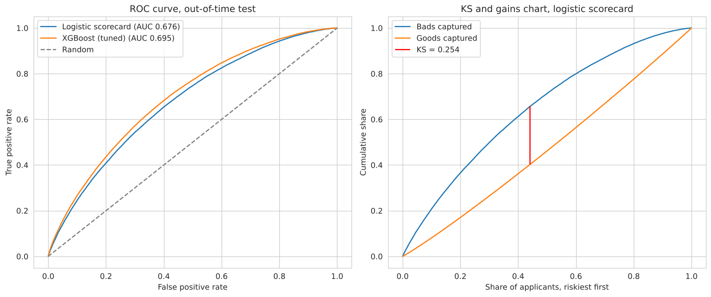
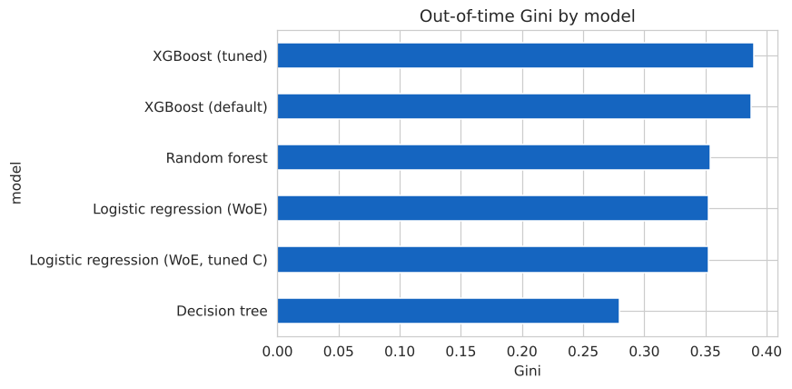
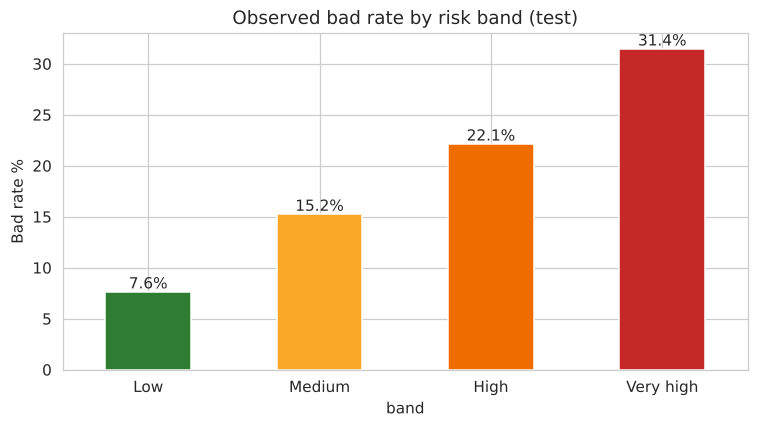
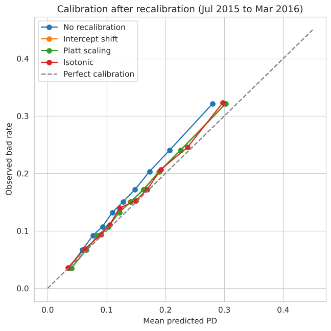
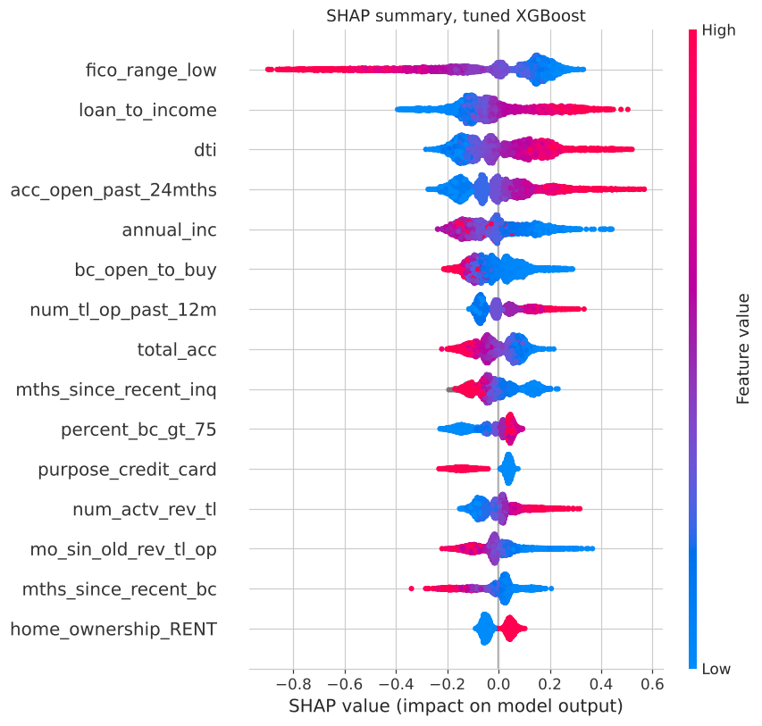
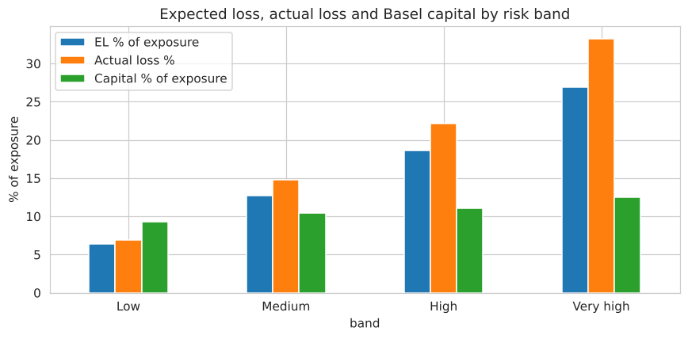

# Probability of Default Model for Consumer Credit Risk

An application scorecard that estimates the lifetime probability of default (PD) for 36-month LendingClub loans, using only information available when the application is made. The model is built on a censoring-aware sample, validated out-of-time and taken through to cut-off selection, risk bands, expected loss and Basel IRB capital.

**Notebook:** [`PD_Model_Consumer_Credit_Risk.ipynb`](PD_Model_Consumer_Credit_Risk.ipynb)

## Key results

Out-of-time test: 372,811 loans originated between January 2015 and March 2016.

| Metric | Result |
|---|---|
| Champion: WoE logistic scorecard | AUC 0.676, Gini 0.353, KS 0.254 |
| Challenger: tuned XGBoost | AUC 0.695, Gini 0.390 |
| Score stability (PSI, train vs test) | 0.002 |
| Bad rate at a 70% approval rate | 10.9%, against 15.2% for the whole book |
| Defaults held by the riskiest 30% of applicants | 49.8% |
| Expected loss and Basel IRB capital | 12.0% and 10.2% of exposure |



## Approach

| Stage | What was done |
|---|---|
| Modelling universe | Kept only loans whose full term ended before the March 2019 data cutoff (right-censoring control); 36-month product |
| Target | Lifetime default: Charged Off or Default = 1, Fully Paid = 0 |
| Leakage controls | Excluded post-origination fields and LendingClub's own grade and interest rate |
| Split | Train 2013 to 2014, test Jan 2015 to Mar 2016 (out-of-time); all fitting on train only |
| EDA | Target balance and drift, missing values, skew, bad rate by feature, correlation, outliers |
| Features | 37 candidates including bureau balances, limits and recency fields; two engineered ratios |
| Scorecard | Decile binning with a separate missing bin, WoE, IV ≥ 0.02, VIF ≤ 5, backward elimination to 18 features with negative coefficients |
| Challengers | Decision tree, random forest, XGBoost |
| Class imbalance | Compared no adjustment, class weights and SMOTE |
| Tuning | Grid and randomised search with time-based cross-validation (`TimeSeriesSplit`) |
| Validation | AUC, Gini, KS, PR-AUC, Brier, bootstrap AUC gap, calibration by decile, stability by period, PSI and CSI |
| Decisioning | Cost-based cut-off, confusion matrix, precision-recall, approval-rate table, risk bands |
| Recalibration | Intercept shift, Platt scaling and isotonic regression compared on a later period |
| Explainability | Scorecard coefficients and SHAP for XGBoost |
| Business output | Scorecard points (PDO 20, base 600 at 50:1), expected loss (PD × LGD × EAD), Basel IRB retail capital and RWA |
| Benchmarking | Comparison with LendingClub grade and interest rate; leakage test |

## Findings

**1. Model choice.** Tuned XGBoost beats the scorecard by 0.019 AUC (95% bootstrap CI 0.017 to 0.020). The WoE logistic scorecard is the champion because every driver is monotonic and explainable, it converts directly into points and decline reasons, and its performance is stable over time.



**2. Class imbalance.** Class weights and SMOTE left Gini unchanged (0.353 against 0.351) but inflated the mean PD from 13% to 47% against an actual bad rate of 15%. The natural class balance is kept and imbalance is handled through the cut-off.

**3. Cut-off and business value.** A cost-based threshold of 0.16 declines 51% of eventual defaulters. Approving the safest 70% of applicants lowers the bad rate from 15.2% to 10.9%.



**4. Calibration and stability.** The bad rate rose from 13.2% in training to 15.2% in test, so raw PDs sit slightly low. An intercept shift corrects the level without changing the ranking. Score PSI is 0.002 and every feature CSI is below 0.04.



**5. Drivers.** FICO, loan-to-income, DTI, recently opened accounts and income drive both models.



**6. Expected loss and capital.** LGD is 88.6% and loans are on average 57% outstanding at default. Expected loss rises from 6.4% of exposure in the Low band to 27.0% in the Very high band, and Basel capital from 9.3% to 12.5%.



## Why the AUC is not 0.9

Many public projects on this dataset report AUC above 0.9. The leakage test in section 22 reproduces this on the same split:

| Model inputs | AUC |
|---|---|
| Application data only (this project) | 0.694 |
| + LendingClub grade and interest rate | 0.707 |
| + FICO score pulled after the loan was issued | 0.947 |
| + payment and recovery columns | 1.000 |

The last two rows use information that does not exist when an application is decided. Using application data only, the scorecard matches LendingClub's own grade (AUC 0.671), and independent leakage-free, out-of-time studies on this dataset report similar results (for example [0.696](https://github.com/meghajoshi-ds/credit-risk-scorecard) and [0.708](https://www.k-dense.ai/examples/session_20260711_204829_f89367ad6d2d/writing_outputs/final/LendingClub_OOT_Default_Prediction_Report.pdf)).

## Limitations

- Marketplace lending data rather than a bank's own underwriting data
- Lifetime PD; the Basel calculation uses an approximate conversion to a 12-month PD
- Portfolio-level LGD and EAD rather than segment models
- No rejected applicants (reject inference not possible) and no macroeconomic variables

## Repository structure

```
├── PD_Model_Consumer_Credit_Risk.ipynb   # full analysis with outputs
├── images/                               # charts used in this README
├── artefacts/scorecard_points.csv        # points for every bin of every scorecard feature
├── requirements.txt
└── README.md
```

## How to run

1. Open the notebook in Google Colab or a local Jupyter environment.
2. Install the dependencies: `pip install -r requirements.txt`
3. Run all cells. The data (about 1.3 GB) is downloaded from Kaggle with `kagglehub` (dataset `wordsforthewise/lending-club`); a Kaggle account may be required. A full run takes 10 to 20 minutes on a standard CPU, most of it in the XGBoost search.

## Tools

Python, pandas, NumPy, statsmodels, scikit-learn, XGBoost, SHAP, imbalanced-learn, matplotlib, seaborn
