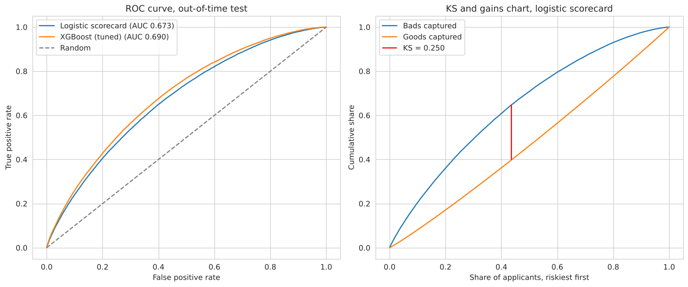
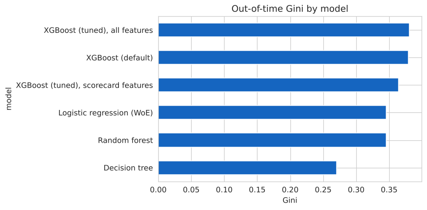
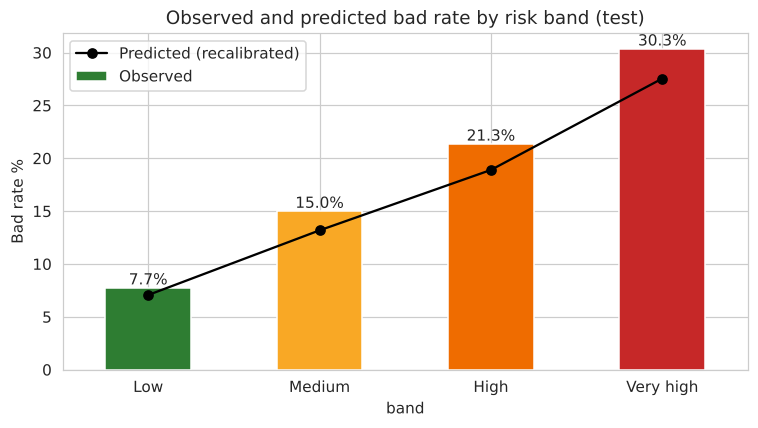
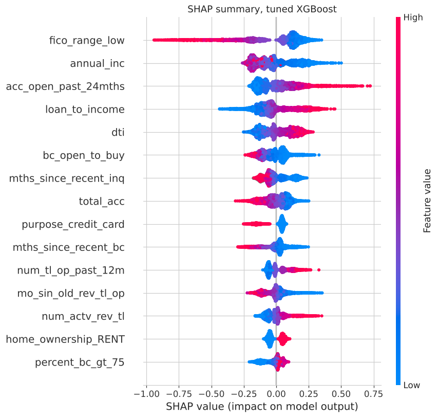

# Probability of Default Model for Consumer Credit Risk

An application scorecard that estimates the lifetime probability of default (PD) for 36-month LendingClub loans, using only information available when the application is made. The model is built on a censoring-aware sample with separate development, validation and out-of-time test periods, and is taken through to cut-off selection, a fixed master scale and calibration testing.

**Notebook:** [`PD_Model_Consumer_Credit_Risk.ipynb`](PD_Model_Consumer_Credit_Risk.ipynb)

## Key results

Out-of-time test: 373,402 loans originated between January 2015 and March 2016.

| Metric | Result |
|---|---|
| Champion: WoE logistic scorecard (17 features) | AUC 0.673, Gini 0.346, KS 0.250 |
| Challenger: tuned XGBoost, all 37 features | AUC 0.690, Gini 0.380 |
| Challenger: tuned XGBoost, the same 17 features | AUC 0.682, Gini 0.364 |
| Score stability (PSI, development vs test) | 0.005 |
| Bad rate at a 70% approval rate | 11.1%, against 15.3% for the whole book |
| Defaults held by the riskiest 30% of applicants | 49.3% |



## Approach

| Stage | What was done |
|---|---|
| Modelling universe | Kept only loans whose full term ended before the March 2019 data cutoff (right-censoring control); 36-month product |
| Target | Lifetime default: Charged Off, Default or 31 to 120 days late = 1; Fully Paid = 0 |
| Leakage controls | Excluded post-origination fields and LendingClub's own grade and interest rate |
| Samples | Development Jan 2013 to Jun 2014; validation Jul to Dec 2014; test Jan 2015 to Mar 2016, scored once |
| EDA | Target balance and drift, missing values, skew, bad rate by feature, correlation, outliers |
| Features | 37 candidates including bureau balances, limits and recency fields; two engineered ratios |
| Coarse classing | Monotonic bins with a 5% minimum size, a separate missing bin and grouping of rare categories |
| Scorecard | WoE, IV ≥ 0.02, VIF ≤ 5, backward elimination to 17 features with negative coefficients |
| Challengers | Decision tree, random forest, XGBoost (on all features and on the scorecard features) |
| Class imbalance | Compared no adjustment, class weights and SMOTE |
| Tuning | Grid and randomised search with time-based cross-validation (`TimeSeriesSplit`) |
| Validation | AUC, Gini, KS, PR-AUC, Brier, bootstrap AUC gap, calibration by decile, stability by period, PSI and CSI |
| Decisioning | Cost-based cut-off set on validation with sensitivity analysis, confusion matrix, approval-rate table |
| Recalibration | Intercept shift, Platt scaling and isotonic regression fitted on validation |
| Risk bands | Fixed master scale from development; binomial test with traffic lights by band |
| Explainability | Scorecard coefficients and SHAP for XGBoost |
| Scorecard points | PDO 20, base 600 at 50:1, recalibration built into the points |
| Benchmarking | Comparison with LendingClub grade and interest rate; leakage test |

## Findings

**1. Model choice.** Tuned XGBoost beats the scorecard by 0.017 AUC (95% bootstrap CI 0.016 to 0.018). On the same 17 features XGBoost reaches 0.682, so about half of the gap comes from the algorithm and half from extra features. The WoE logistic scorecard is the champion because every driver is monotonic and explainable, it converts directly into points and decline reasons, and its performance is stable over time.



**2. Class imbalance.** Class weights and SMOTE left Gini unchanged (0.346 against 0.345) but inflated the mean PD from 13% to 47% against an actual bad rate of 15%. The natural class balance is kept and imbalance is handled through the cut-off.

**3. Cut-off and business value.** A cost-based threshold of 0.16, set on the validation sample, declines 30% of test applicants and 49% of eventual defaulters. The threshold moves from 0.25 to 0.11 as the assumed cost ratio rises from 3:1 to 8:1. Approving the safest 70% of applicants lowers the bad rate from 15.3% to 11.1%.

**4. Calibration and stability.** The applicant population is stable (score PSI 0.005, every feature CSI below 0.05) and Gini holds across test periods. The bad rate, however, rose from 12.7% in development to 15.3% in test. Recalibration on the validation period narrows the gap, but the binomial test is red in every risk band: the ranking is sound while the PD level is too low for 2015 to 2016 originations, which would trigger recalibration on more recent vintages in production.



**5. Drivers.** FICO, income, recently opened accounts, loan-to-income and DTI drive both models.



## Why the AUC is not 0.9

Many public projects on this dataset report AUC above 0.9. The leakage test in section 21 reproduces this on the same split:

| Model inputs | AUC |
|---|---|
| Application data only (this project) | 0.689 |
| + LendingClub grade and interest rate | 0.703 |
| + FICO score pulled after the loan was issued | 0.944 |
| + payment and recovery columns | 1.000 |

The last two rows use information that does not exist when an application is decided. Using application data only, the scorecard matches LendingClub's own grade (AUC 0.670). Comparable public projects that exclude leakage and test out-of-time report similar figures, for example [0.696](https://github.com/meghajoshi-ds/credit-risk-scorecard) and [0.708](https://www.k-dense.ai/examples/session_20260711_204829_f89367ad6d2d/writing_outputs/final/LendingClub_OOT_Default_Prediction_Report.pdf).

## Limitations

- Marketplace lending data from approved applicants only (no reject inference)
- Lifetime default target; Basel and IFRS 9 Stage 1 use a 12-month PD
- Prepayment is not modelled as a competing risk
- Charged-off status differs from the regulatory 90-days-past-due default definition
- Development and test cover a benign economic period (2013 to 2016)
- PD only: LGD and EAD are out of scope

## Repository structure

```
├── PD_Model_Consumer_Credit_Risk.ipynb   # full analysis with outputs
├── images/                               # charts used in this README
├── artefacts/scorecard_points.csv        # points for every bin of every scorecard feature
├── requirements.txt
└── README.md
```

## How to run

1. Open the notebook in Google Colab or a local Jupyter environment.
2. Install the dependencies: `pip install -r requirements.txt`
3. Run all cells. The data (about 1.3 GB) is downloaded from Kaggle with `kagglehub` (dataset `wordsforthewise/lending-club`); a Kaggle account may be required. A full run takes 10 to 20 minutes on a standard CPU, most of it in the XGBoost search.

## Tools

Python, pandas, NumPy, SciPy, statsmodels, scikit-learn, XGBoost, SHAP, imbalanced-learn, matplotlib, seaborn
